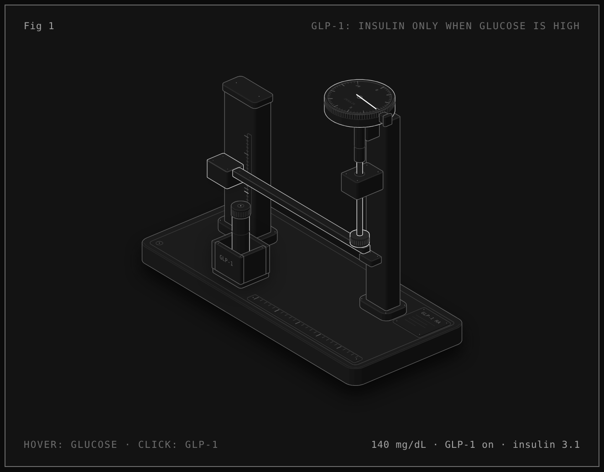

# How GLP-1 Drugs Work

GLP-1 drugs (glucagon-like peptide-1 receptor agonists) include semaglutide (Ozempic, Wegovy), tirzepatide (Mounjaro, Zepbound) and liraglutide (Victoza, Saxenda).

## The natural hormone
GLP-1 is a hormone your gut releases after you eat. It tells your body that food has arrived. The body's own GLP-1 breaks down within about 2 minutes, because an enzyme called DPP-4 destroys it.

## What the drugs do
The drugs are altered versions of GLP-1 that resist breakdown, so they last for days. That's why many are taken as a weekly shot. They bind the same GLP-1 receptors as the natural hormone and act on several organs at once:

1. **Pancreas: insulin rises only when blood sugar is high.** The drug makes beta cells release more insulin, but only when glucose is high. On their own, they rarely cause low blood sugar. They also reduce glucagon, a hormone that tells the liver to release sugar.
2. **Stomach: emptying slows.** Food leaves the stomach more slowly, so blood sugar rises less after meals and you feel full longer. This is also the main cause of nausea.
3. **Brain: appetite drops.** GLP-1 receptors in the hypothalamus and brainstem reduce hunger and the urge to eat. Many users say "food noise" gets quieter. This is the main reason for the weight loss, often 15–20% of body weight with the newer drugs.
4. **Other effects:** They lower the risk of heart attack and stroke, help the kidneys, and reduce inflammation. Researchers are also studying them for fatty liver, sleep apnea and addiction.

## Newer versions
- **Tirzepatide** acts on two receptors, GLP-1 and GIP, which generally gives stronger weight loss.
- **Retatrutide** (still in trials) acts on three: GLP-1, GIP and glucagon.
- **Oral options** exist, such as Rybelsus (oral semaglutide), and pill forms like orforglipron are in development or newly available.

## Side effects and cautions
- **Common:** nausea, vomiting, diarrhea or constipation, especially when starting or raising the dose.
- **Muscle loss:** some of the weight lost can be muscle, so protein and strength training help.
- **Less common but serious:** pancreatitis and gallbladder problems.
- **Thyroid warning:** they're not recommended for people with a personal or family history of medullary thyroid cancer or MEN2. This is based on studies in rodents.
- **Weight regain:** weight often comes back after stopping the drug.

---

*This is general information, not medical advice. A doctor can tell you which drug and dose fit your health history.*

## Figure: insulin only when glucose is high

`figures/glp1-gate/glp1-gate.html` is an interactive version (download it and open it in a browser; there is also a `-light` version). Hover to change blood glucose; click to seat or lift the GLP-1 cartridge. Below about 90 mg/dL the plunger stays on its ledge whether the drug is in or not; above it, the drug doubles the insulin reading (the 2× is illustrative). Built with the [Anatomy](https://github.com/wheresryan22/anatomy) skill; `build.mjs` rebuilds it.
